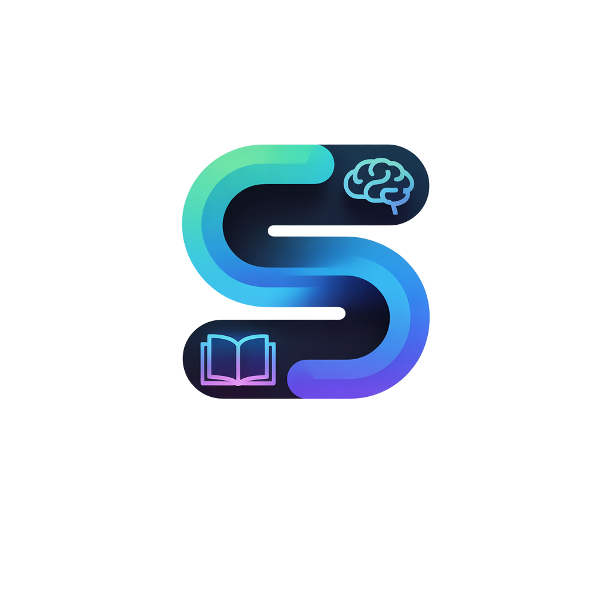
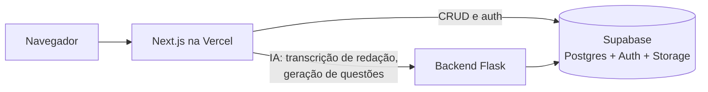

<p align="center">
  
</p>

<h1 align="center">StudyTrack — frontend</h1>

<p align="center">
  <strong>Plataforma SaaS B2B para cursinhos pré-vestibular: cada escola ganha um
  portal com a própria marca, onde gestores acompanham a turma e alunos estudam
  para o ENEM e vestibulares.</strong>
</p>

<p align="center">
  <a href="https://www.studytrack.com.br">studytrack.com.br</a>
</p>

<p align="center">
  
  
  
  
  
</p>

---

## O produto

A StudyTrack é vendida para **cursinhos**, não direto para o aluno. Cada escola
parceira recebe um portal white-label em `/partners/<escola>` com suas cores,
logo e módulos contratados.

| Área | O que tem |
|---|---|
| **Gestão do cursinho** | Dashboard da turma, alunos e convites, simulados (agendamento, correção e resultados), redações, ranking, aulas em vídeo, planos e configurações |
| **Aluno** | Dashboard, banco de questões, simulados com revisão, envio de redação (inclusive por foto), desempenho por área, ranking, títulos e sequência de estudos |

Módulos como ranking, redações e aulas são ligados ou desligados por escola.

## Arquitetura



- **Multi-tenant por organização.** Um `OrgContext` entrega marca, permissões
  por módulo e plano da escola atual; as cores viram variáveis CSS
  (`--brand-primary`, `--brand-secondary`, `--brand-accent`) em todo o portal.
- **Auth e papéis no servidor.** O middleware valida a sessão do Supabase e os
  Server Components decidem o destino de cada papel (gestor, aluno, equipe interna).
- **SSR híbrido.** Páginas pesadas buscam dados no servidor e entregam HTML já
  populado a um *client shell*, sem tela de carregamento inicial.
- **IA fora do frontend.** Nenhuma rota daqui chama um modelo diretamente: o
  backend Flask concentra as chamadas e as chaves.

Decisões e trade-offs em detalhe: [`CONTEXT.md`](CONTEXT.md). Mapa do código:
[`CLAUDE.md`](CLAUDE.md). Guia visual: [`LIGHT-DESIGN-GUIDELINES.md`](LIGHT-DESIGN-GUIDELINES.md).

## Stack

| Camada | Tecnologia |
|---|---|
| Framework | Next.js 16 (App Router), React 19 |
| Linguagem | TypeScript |
| Dados | Supabase, SWR |
| UI | Tailwind CSS, Radix UI (shadcn), Lucide, Framer Motion, GSAP |
| Gráficos e conteúdo | Recharts, React Markdown, KaTeX |
| Uploads | tus (uploads retomáveis) |
| Deploy | Vercel |

## Rodando localmente

```bash
git clone https://github.com/kauaguerrero/studytrack-frontend
cd studytrack-frontend
npm install
npm run dev        # http://localhost:3000
```

Crie um `.env.local` com:

| Variável | Uso |
|---|---|
| `NEXT_PUBLIC_SUPABASE_URL`, `NEXT_PUBLIC_SUPABASE_ANON_KEY` | Acesso público ao Supabase |
| `SUPABASE_URL`, `SUPABASE_SERVICE_ROLE_KEY` | Somente rotas de API no servidor; nunca expor ao navegador |
| `NEXT_PUBLIC_API_URL` | URL do backend Flask (padrão `http://127.0.0.1:5000`) |

## Testes

Scripts de verificação da lógica de negócio:

```bash
npm run lint
npm run test:essay-credits      # créditos de correção de redação
npm run test:student-theme      # tema do aluno
npm run test:task-intelligence  # priorização de tarefas
npm run test:dev-role           # regras do papel dev
npm run test:overview-metrics   # paridade das métricas do painel
```

## Estrutura

```
src/
  app/
    (public)/              landing page, login e recuperação de senha
    partners/[slug]/       portal white-label: gestão e área do aluno (student/)
    portal/                painel interno da equipe e redirecionamento por papel
    api/                   rotas de servidor
  components/
    partners/              layout do portal, guardas de módulo, gamificação
    landing/               página de vendas
    ui/                    primitivos (shadcn/Radix)
  contexts/                organização, tema do aluno, notificações
  lib/supabase/            clientes (navegador, SSR, admin) e middleware
```

## Equipe

Construída por **Kauã Guerrero** ([@kauaguerrero](https://github.com/kauaguerrero))
e **Igor Cruz** ([@IgorCruz-dev](https://github.com/IgorCruz-dev)), co-fundadores.

---

<sub>Código proprietário. Todos os direitos reservados.</sub>
